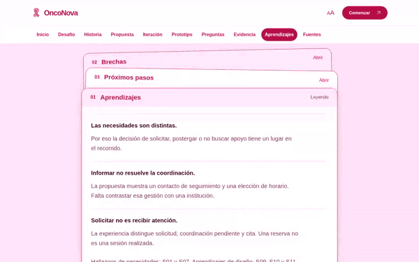
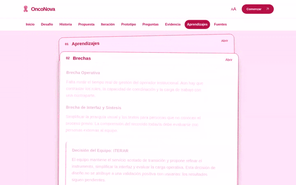
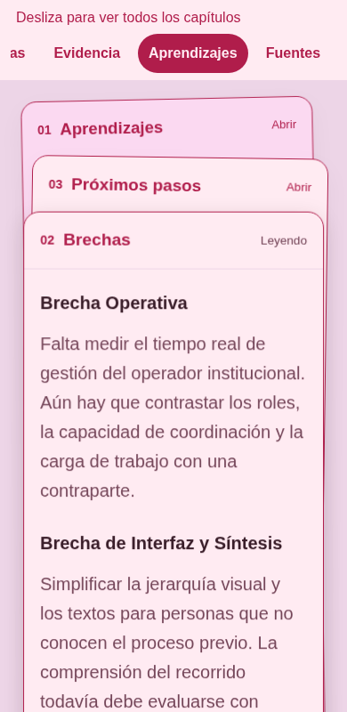
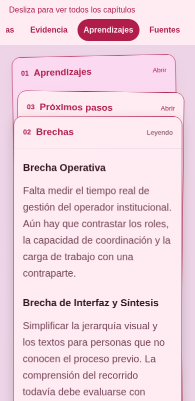

# Revisión del movimiento de las tarjetas · 19/10/2026

Rama `fix/reading-card-motion`, sobre `main` en `75eda91`. El checkout inicial
estaba limpio en `b40cdef`; se incorporó `main` por avance rápido antes de editar.
La comparación visual usa el sistema de tarjetas anterior, que no cambió entre
esos commits. No se modifica el índice incorporado por `main`.

## Observación y decisiones

Se reprodujeron avance y retroceso en Chromium, diferenciando panel, superficies,
capas y contenido. La compensación FLIP evitaba el salto de posición inicial,
pero usaba 500 ms frente a los 300 ms de las tarjetas; la curva compartida
adelantaba gran parte del recorrido. El cambio inmediato de `z-index` tapaba la
saliente, y `hidden` retiraba su texto antes de poder seguir la salida.

| Antes | Después | Motivo |
| --- | --- | --- |
| Panel 500 ms y tarjetas 300 ms con `--ease-out` | Mazo 600 ms con `cubic-bezier(0.4,0,0.2,1)` | Mantener perceptibles salida y llegada, con el mismo ritmo espacial. |
| `z-index` 1/2/3 inmediato | Rango 0/100/200 interpolado con el desplazamiento | Relevar superficies opacas cuando se cruzan. |
| Altura determinada por el contenido saliente | Altura medida interpolada en 600 ms | Evitar que una superficie alta colapse al ocultar su texto, sin escalar letras. |
| Retirada inmediata del contenido | Entrada de opacidad 200 ms con `--ease-out`; salida durante los 600 ms del mazo | Conservar la identidad de la saliente, sin superponer textos. |
| Margen de lectura fijo de 96 px | `max(160 px, 0.3 × viewport útil)` después del desborde real de tarjeta y controles | Leer el final antes de cambiar; selección y navegación comparten los mismos hitos. |

Los tokens son exclusivos de `.reading-panel`; las otras animaciones conservan
sus duraciones. FLIP sigue tomando la posición presentada, incluida una animación
interrumpida, y solo compensa el salto del layout. La página sigue desplazándose
nativamente. No se añaden dependencias, capturas de wheel/touch, temporizadores,
colas, inercia simulada ni bloqueos de controles.

El texto saliente pasa a `inert` y `aria-hidden` inmediatamente; `hidden` se aplica
al terminar su transición de opacidad. Una reversión retoma la opacidad actual.
También se limpia el caso de una llegada reemplazada antes de pintar, que no
emite `transitionend`. El foco sale de una sección antes de volverla inactiva.
Teclado, reducción de movimiento, reflujo e impresión eliminan los desplazamientos
temporales. Imprimir libera además `hidden`, `inert` y `aria-hidden` en las tres
secciones; al volver se recupera el modo de lectura.

La posición y la entrada/salida del texto usan `transform` y `opacity`. Se
interpola también `z-index` para el orden de pintura. La altura real de las tres
superficies absolutas acompaña los 600 ms: conservar el texto saliente no debe
hacer colapsar su fondo al terminar. Esta interpolación requiere layout local,
sin modificar el flujo del documento ni escalar la tipografía. Se eligió frente
a una compensación de escala que deformara el texto. El contenido se recorta al
borde de su superficie y el foco del cuerpo conserva su contorno visible por
dentro; en impresión se restablecen altura automática y desborde visible.
Los controles usan la capa 201 para permanecer alcanzables mientras una tarjeta
alta pasa detrás. El panel aísla ese rango de capas para respetar la navegación
fija de la página. No se afirma que todo el movimiento sea exclusivamente de
compositor ni se extrapola rendimiento de localhost a dispositivos reales.

## Recorrido medido

Distancias entre los hitos de Aprendizajes → Brechas y Brechas → Próximos pasos,
en píxeles CSS, con texto normal y el contenido real:

| Viewport | Antes | Después |
| --- | --- | --- |
| 1440 × 900 | 254 / 310 | 368 / 425 |
| 390 × 800 | 599 / 757 | 702 / 859 |
| 768 × 1024 | 174 / 219 | 326 / 371 |
| 1024 × 768 | 386 / 442 | 461 / 517 |

Las pruebas comprueban que el final completo, incluidos los controles, queda
visible antes del cambio. El espacio adicional es de lectura; no se añadió un
bloque vacío fijo a la página. A 320 px y con texto ampliado se utiliza lectura
lineal, sin depender del mazo.

## Evidencia visual

Grabaciones de Chromium con la página a velocidad normal, recortadas temporalmente
y reducidas a 600 px y 10 fps para este documento. No sirven para medir fluidez
ni comparar cuadros en el mismo instante: los hitos y duraciones son distintos.
La secuencia incluye cruces hacia delante y atrás y un desplazamiento rápido.

Antes:

Después:

En móvil, una muestra intermedia de la secuencia anterior y de la nueva salida:

| Antes, 390 px | Después, 390 px |
| --- | --- |
|  |  |

Se inspeccionaron grabaciones y cuadros a velocidad normal y a un cuarto de
velocidad en los cuatro tamaños de la tabla. La prueba de movimiento también
pausa y muestrea las transiciones efectivas, incluyendo los seis pares de cambio
entre tarjetas, sin deducir continuidad solamente del estado final.

## Comprobación y segunda revisión

- `node scripts/check.mjs`, `node scripts/build.mjs`, `node --check site/assets/app.js` y `git diff --check`: aprobados.
- `python3 scripts/test-reading-guide.py`: [22 casos aprobados](reading-guide.json), con los cinco anchos 1440/390/768/1024/320, preferencias normal/reducida, controles de selección y anterior/siguiente, fragmentos, historia, teclado/foco, tarjetas altas, pan durante movimiento, pinch emulado, lectura lineal, texto ampliado, tres fallbacks, impresión y zoom nativo de Chromium al 200 %.
- `python3 scripts/test-reading-motion.py`: [9 escenarios aprobados](reading-motion.json), con seis pares de cambio por tamaño, muestreo de capas/altura/opacidad, comparación a 599 ms y tras terminar, contenido activo sin recorte, inversión durante el movimiento, scroll rápido, foco seguro, controles alcanzables, orientación, ampliación de texto, cambios de preferencia e impresión durante una transición. Se conserva la prueba de continuidad del primer cuadro, descontando el scroll nativo.
- `python3 scripts/test-section-index.py`: [10 casos aprobados](section-index.json), repetidos tras aislar las capas frente al índice fijo.
- Smoke acotado con Playwright en `/` y `/prototipo/`, a 1440 y 390 px: [4 casos aprobados](smoke.json), con carga, teclado básico, ampliación de texto y solicitud → mensaje → horarios de ejemplo. Se usaron selectores vigentes; el smoke genérico de la skill corresponde a una simulación anterior y no se presenta como ejecutado.
- Selección de texto con arrastre nativo del mouse e inspección visual del foco en móvil/escritorio: aprobadas. Extracción del PDF de impresión: contiene el texto de las tres tarjetas. Los recorridos automatizados no registraron errores de página/consola ni los fallos HTTP que comprueban las pruebas de lectura y smoke.

Las esperas de reposo usan las animaciones y sus estados efectivos, incluida la
limpieza tras `transitionend`; no se conserva el límite anterior de 300 ms. El
modo sin JavaScript no espera callbacks de página que el navegador deshabilita.
Las pausas breves restantes sirven para gestos o interrupciones deliberadas. El
pinch emulado empieza después de `scrollend` y recorre suficiente distancia para
superar el umbral nativo de reconocimiento.

Segunda pasada del diff realizada después de implementar, con `revision-landing`,
`review-animations`, `web-design-guidelines` y `docs/code_review.md`, sin subagentes.
Se revisaron alcance, geometría, interrupciones, semántica, foco, contenido sin JS,
reflujo y superficies opacas. Se corrigieron las regresiones propias de limpieza
de contenido transparente en una tercera selección, la superficie saliente alta
que interceptaba clics del nuevo pie y el alcance de las capas frente al índice
fijo. Una comprobación del borde inferior detectó y corrigió el colapso tardío
del fondo de una tarjeta alta al ocultar su texto. La prueba muestrea la altura a
599 ms y al terminar, además de las inversiones. Se reforzó la exposición
semántica al imprimir y se eliminó el estado de dirección que dejó de utilizarse.

Decisión de movimiento: **aprobado para revisión del equipo** en el alcance
comprobado. Los 600 ms tienen la función solicitada de mostrar el relevo del
relato; las acciones de teclado siguen siendo inmediatas. La revisión del mismo
agente no sustituye la aprobación de otra persona requerida para integrar.

Límites: Chromium headless en este entorno; celular/tablet y sus gestos emulados,
no dispositivos físicos. No se probaron Safari, Firefox, VoiceOver/TalkBack ni una
sesión escuchada con lector de pantalla. Las comprobaciones de atributos/foco y
el zoom de Chromium no certifican accesibilidad completa ni compatibilidad con
Safari. No se evaluaron comprensión con usuarias ni rendimiento en hardware real.
Las pruebas técnicas no validan el servicio académico. Sin merge ni publicación.
